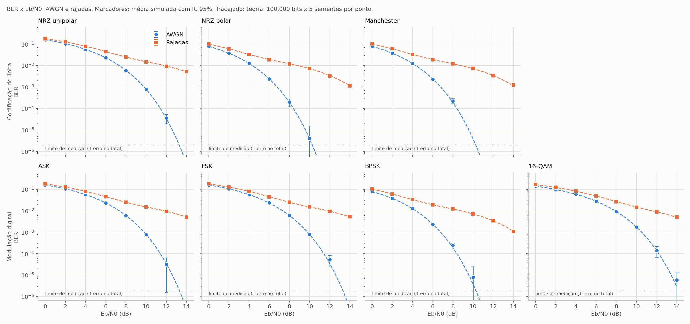
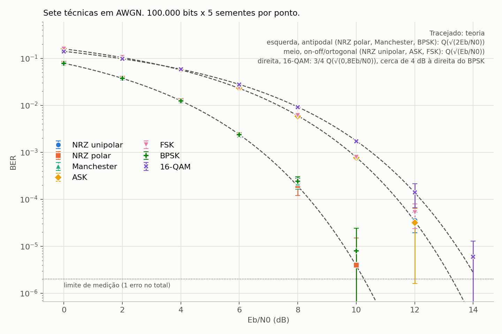
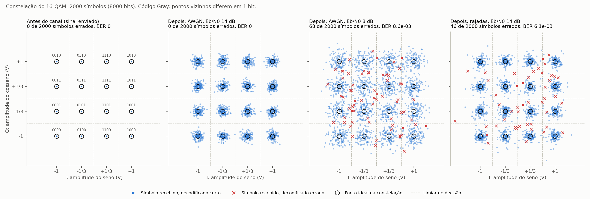

# Simulador de Transmissão Digital: Codificação de Linha, Modulação e Canal Ruidoso

Projeto prático do Grau B (GB) da disciplina de Redes de Computadores (UNISINOS). O trabalho implementa um sistema de comunicação digital ponta a ponta: uma mensagem ASCII é convertida em bits, codificada ou modulada em um sinal, enviada por um canal com ruído, demodulada no receptor e comparada com o original. O objetivo é medir como o ruído afeta a taxa de erro de bits (BER) de cada técnica.

## 📋 Índice

1. [Visão Geral e Objetivos](#-visão-geral-e-objetivos)
2. [Arquitetura do Sistema](#-arquitetura-do-sistema)
3. [Conceitos Implementados](#-conceitos-implementados)
   1. [Codificação de linha x codificação de correção de erros](#1-codificação-de-linha-x-codificação-de-correção-de-erros)
   2. [Técnicas de codificação de linha](#2-técnicas-de-codificação-de-linha-banda-base)
   3. [Técnicas de modulação digital](#3-técnicas-de-modulação-digital)
   4. [Modelos de canal](#4-modelos-de-canal)
   5. [Métricas: BER, Eb/N0 e eficiência espectral](#5-métricas-ber-ebn0-e-eficiência-espectral)
4. [Estrutura do Repositório](#-estrutura-do-repositório)
5. [Pré-requisitos e Execução](#️-pré-requisitos-e-execução)
6. [Guia de Testes e Experimentos](#️-guia-de-testes-e-experimentos)
   1. [Teste 1: validação funcional (`testes.py`)](#teste-1-validação-funcional-testespy)
   2. [Teste 2: figuras dos sinais (`main.py`)](#teste-2-figuras-dos-sinais-mainpy)
   3. [Teste 3: sessão com containers Docker](#teste-3-sessão-com-containers-docker)
   4. [Teste 4: modo interativo](#teste-4-modo-interativo)
   5. [Teste 5: plano experimental (`experimentos.py`)](#teste-5-plano-experimental-experimentospy)
7. [Parâmetros Configuráveis](#️-parâmetros-configuráveis)
8. [Dados Coletados e Reprodutibilidade](#-dados-coletados-e-reprodutibilidade)
9. [Resultados e Análise](#-resultados-e-análise)
10. [Demonstração em Vídeo](#-demonstração-em-vídeo)
11. [Demonstração em Vídeo - Teste interativo](#-demonstração-em-vídeo---teste-interativo)

---

## 🎯 Visão Geral e Objetivos

O simulador cobre toda a cadeia de uma transmissão digital:

```
mensagem ASCII → bits → codificação/modulação → canal ruidoso → demodulação → bits → mensagem recebida
```

Em cima dessa cadeia, o projeto:

- compara **sete técnicas** (três codificações de linha e quatro modulações, uma delas de ordem superior: 16-QAM) sob o mesmo ruído;
- usa dois cenários de canal: **AWGN** (ruído gaussiano branco) e **rajadas** (ruído em surtos, modelo Gilbert-Elliott), além do **canal ideal** para o teste de consistência;
- calcula a **BER** simulada e a compara com a **BER teórica**;
- calcula a **eficiência espectral nominal** (bits/s/Hz) e monta a tabela de compromisso entre BER e eficiência;
- roda cada ponto com **100.000 bits** e **5 repetições** independentes, com intervalo de confiança de 95%.

A transmissão pode rodar de duas formas, usando o mesmo código das técnicas e do canal:

| Modo | O que é | Para que serve |
|---|---|---|
| **Containers Docker** | Três processos (transmissor, canal, receptor) conversando por TCP | Demonstrar o sistema como uma rede de verdade e registrar cada quadro |
| **Local (`experimentos.py`)** | Tudo em um processo, sem sockets | Rodar milhões de bits rápido para gerar as curvas finais |

---

## 🏗 Arquitetura do Sistema


```
transmissor ──TCP:5000──▶ canal ──TCP:5001──▶ receptor
```

| Container | Arquivo | O que faz |
|---|---|---|
| **transmissor** | `transmissor.py` | Converte a mensagem ASCII (ou bits aleatórios) em bits, gera o sinal com a técnica escolhida e envia o quadro ao canal. Também tem um modo interativo (digite uma frase e ela é transmitida). |
| **canal** | `canal.py` | Soma o ruído ao sinal conforme o cenário (`ideal`, `awgn` ou `rajadas`) e o Eb/N0 pedido, e repassa ao receptor. É o único ponto que vê o sinal **antes e depois** do ruído, então guarda os dois em `logs/canal/`. |
| **receptor** | `receptor.py` | Demodula/decodifica o sinal ruidoso, reconstrói a mensagem, aponta quais bits e caracteres vieram errados e calcula a BER. Grava tudo em `logs/`. |

**Protocolo entre os containers** (`protocolo.py`): cada quadro é enviado numa conexão TCP nova, com 4 bytes de tamanho, um cabeçalho JSON (técnica, cenário, Eb/N0, número de bits) e as amostras do sinal em `float64`. O cabeçalho também leva os bits originais como *referência fora de banda*: o receptor **não** os usa para decodificar, só para contar e localizar os erros.

O ruído de cada quadro usa uma semente derivada do número do quadro, então repetir a sessão reproduz exatamente os mesmos resultados.

---

## 📚 Conceitos Implementados

### 1. Codificação de linha x codificação de correção de erros

São duas coisas diferentes, e é comum confundi-las:

| | **Codificação de linha** | **Codificação de correção de erros (canal)** |
|---|---|---|
| **Pergunta que responde** | *Como represento cada bit como nível de tensão no meio físico?* | *Como adiciono redundância para detectar ou corrigir bits errados?* |
| **Muda** | O formato da onda (níveis, transições, componente DC) | A sequência de bits (mais bits do que a mensagem original) |
| **Objetivo** | Sincronismo, ausência de componente DC, uso adequado da banda | Reduzir a BER com o mesmo ruído, ao custo de taxa útil |
| **Exemplos** | NRZ, Manchester, AMI | Hamming, CRC (detecção), Reed-Solomon, convolucional |

Neste projeto são implementadas **codificações de linha**. **Não há** código corretor de erros: toda a BER medida é a do enlace "puro", sem correção, o que é justamente o que permite comparar as técnicas entre si.

### 2. Técnicas de codificação de linha (banda base)

Em `codificador.py`. Aqui o próprio nível de tensão carrega o bit, sem portadora.

| Técnica | Regra | Característica |
|---|---|---|
| **NRZ unipolar** | bit 1 → +V, bit 0 → 0 | Simples, mas tem componente DC e não tem transição em sequências de bits iguais |
| **NRZ polar** | bit 1 → +V, bit 0 → −V | Média zero e níveis mais separados (2V), logo mais resistente a ruído. Ainda sem sincronismo em bits repetidos |
| **Manchester** (IEEE 802.3) | bit 1 → subida no meio do bit, bit 0 → descida | Transição em todo bit (autossincronizado) e sem componente DC. Custo: ocupa o dobro da banda |

### 3. Técnicas de modulação digital

Em `modulador.py`. Os bits alteram um parâmetro de uma portadora senoidal, deslocando o sinal para uma faixa de frequência (necessário em canais passa-faixa, como o rádio).

| Técnica | Parâmetro alterado | Regra | Observação |
|---|---|---|---|
| **ASK** | Amplitude | bit 1 → portadora de 1 V, bit 0 → silêncio | Mais simples e mais sensível a ruído |
| **FSK** | Frequência | bit 1 → 7 kHz, bit 0 → 3 kHz | Amplitude constante, mas ocupa mais banda |
| **BPSK** | Fase | bit 1 → fase 0°, bit 0 → fase 180° | Formas de onda opostas: a mais resistente a ruído |
| **16-QAM** | Amplitude e fase | 4 bits por símbolo: 2 bits escolhem a amplitude do seno (I) e 2 a do cosseno (Q), cada uma com 4 níveis | **Ordem superior**: 4× a eficiência do BPSK, mas os 16 pontos ficam mais próximos e o ruído os confunde com mais facilidade |

Todas as frequências são múltiplos inteiros da taxa de bits, então cada bit contém um número inteiro de ciclos. O receptor demodula por **correlação** com a portadora de referência.

**Sobre o 16-QAM (modulação de ordem superior):** ASK, FSK e BPSK são binárias, ou seja, cada símbolo carrega 1 bit. No 16-QAM cada símbolo carrega **4 bits** (16 combinações), então o símbolo dura 4 vezes mais para a mesma taxa de bits e o sinal ocupa um quarto da banda. O mapeamento usa **código Gray**: pontos vizinhos da constelação diferem em um único bit, e assim o erro mais comum (cair no ponto vizinho) custa só 1 bit errado. O número de bits da mensagem precisa ser múltiplo de 4, o que o ASCII (8 bits por caractere) já garante.

### 4. Modelos de canal

Em `canal.py`. O ruído é controlado por **Eb/N0 em dB** (e não pelo desvio padrão), para que todas as técnicas sejam comparadas com a **mesma energia por bit**.

| Cenário | `CANAL_TIPO` | Descrição |
|---|---|---|
| **Ideal** | `ideal` | Nenhum ruído. Usado no teste de consistência |
| **AWGN** | `awgn` | Ruído gaussiano branco, mesmo desvio padrão em todo o sinal |
| **Rajadas** | `rajadas` | AWGN **mais** surtos de ruído forte. Um modelo de **Gilbert-Elliott** alterna, bit a bit, entre o estado BOM (ruído normal) e o RUIM (ruído `RAJADA_DB` dB mais forte). Por padrão, 1% dos bits iniciam uma rajada, que dura em média 10 bits, com ruído 10 dB mais forte |

Isso representa interferências reais, como um motor ligando perto de um cabo, que causam erros em grupo e não bits isolados.

### 5. Métricas: BER, Eb/N0 e eficiência espectral

- **BER** (*Bit Error Rate*): fração dos bits recebidos que estão errados. `BER = bits errados / bits transmitidos`.
- **Eb/N0** (dB): energia por bit dividida pela densidade espectral do ruído. É a "relação sinal-ruído" normalizada por bit, usada nas curvas BER × SNR.
- **BER teórica** em AWGN: `Q(√(K · Eb/N0))`, com K = 2 para sinais antipodais (NRZ polar, Manchester, BPSK) e K = 1 para on-off e ortogonais (NRZ unipolar, ASK, FSK). Os dois grupos ficam separados por 3 dB. O 16-QAM com código Gray tem fórmula própria: `3/4·Q(a) + 1/2·Q(3a) − 1/4·Q(5a)`, com `a = √(0,8 · Eb/N0)`.
- **Eficiência espectral nominal** (bits/s/Hz): taxa de bits dividida pela banda ocupada até o primeiro nulo do espectro.

| Técnica | Banda nominal | Eficiência (bit/s/Hz) |
|---|---|---|
| NRZ unipolar / NRZ polar | Rb | 1,0 |
| Manchester | 2·Rb | 0,5 |
| ASK / BPSK | 2·Rb | 0,5 |
| FSK | \|f1−f0\| + 2·Rb | 0,17 |
| 16-QAM | Rb/2 | 2,0 |

(Com Rb = 1000 bit/s, f0 = 3 kHz e f1 = 7 kHz.)

---

## 📂 Estrutura do Repositório

```
Trabalho-Redes-GrauB/
├── codificador.py        # Codificação de linha: NRZ unipolar, NRZ polar, Manchester
├── modulador.py          # Modulação: ASK, FSK, BPSK, 16-QAM (e demoduladores)
├── ruido.py              # Registro das técnicas, BER teórica, adição de ruído simples
├── canal.py              # Canal: ideal / AWGN / rajadas (e servidor TCP)
├── mensagem.py           # Texto ASCII <-> bits
├── protocolo.py          # Formato dos quadros trocados pelos containers
├── transmissor.py        # Container 1: gera e envia o sinal
├── receptor.py           # Container 3: demodula, reconstrói e registra
├── experimentos.py       # Plano experimental (BER x Eb/N0, 100 mil bits, 5 repetições)
├── graficos.py           # Estilo e funções de desenho comuns
├── graficos_sessao.py    # Gráficos a partir dos logs de uma sessão Docker
├── main.py               # Figuras dos sinais e teste rápido de BER (sem rede)
├── testes.py             # Testes de validação
├── Dockerfile            # Imagem única (Python) usada pelos três containers
├── docker-compose.yml    # Declaração dos containers e variáveis de ambiente
├── requirements.txt      # numpy e matplotlib
└── README.md
```

A pasta `resultados/` (gerada pelo `experimentos.py`) está versionada, com os resultados brutos e os gráficos finais. As pastas `logs/` (sessões Docker) e `graficos/` (`main.py`) são geradas ao executar.

---

## ⚙️ Pré-requisitos e Execução

### Pré-requisitos

- **Para os containers:** Docker Engine e Docker Compose v2 (`docker compose`).
  - **Windows:** Docker Desktop com backend WSL 2.
  - **Linux:** Docker instalado, com seu usuário no grupo `docker` (ou use `sudo`).
- **Para rodar localmente (sem Docker):** Python 3.10+ e as bibliotecas do `requirements.txt`.

### Como rodar (Docker)

Abra o Docker Desktop e use **3 terminais**, todos na pasta do projeto. Cada terminal roda uma parte do sistema.

**Terminal 1: receptor** (mostra o texto que chegou e os bits errados)

```bash
docker compose up --build receptor
```

**Terminal 2: canal** (mostra qual ruído está sendo aplicado)

```bash
docker compose up canal
```

**Terminal 3: transmissor** (é onde você digita a mensagem)

```bash
docker compose run --rm transmissor python transmissor.py --interativo
```

Pronto. No terminal 3, digite uma frase em ASCII (sem acento) e tecle Enter: ela passa pelo canal e o resultado aparece nos terminais 1 e 2. Para escolher o ruído, use estes comandos no mesmo terminal:

| Comando | O que faz |
|---|---|
| `/canal ideal` | Sem ruído |
| `/canal awgn` | Ruído gaussiano (erros isolados) |
| `/canal rajadas` | Ruído em surtos (erros em grupo) |
| `/ebn0 4` | Define o nível de ruído em dB (menor = mais ruído) |
| `/tecnica BPSK,ASK` | Escolhe as técnicas (ou `/tecnica todas`) |
| `/sair` | Encerra |

Exemplo de demonstração, digitando no terminal 3:

```
/tecnica BPSK,ASK
/canal ideal
OLA REDES
/canal awgn
/ebn0 4
OLA REDES
/canal rajadas
OLA REDES
```

**Para desligar:** `/sair` no terminal 3, `Ctrl+C` nos terminais 1 e 2, e depois `docker compose down`.

#### Gráficos do que você transmitiu

Depois da demonstração, gere as figuras de sinal limpo × sinal com ruído. O `<id>` é o número no nome do arquivo `logs/sessao_<id>.log`:

```bash
python graficos_sessao.py --sessao <id>
```

Os arquivos aparecem em `logs/graficos_<id>/`.

#### Modo automático (opcional)

Em vez de digitar, o transmissor pode testar tudo sozinho: envia a mensagem em todas as técnicas e cenários e depois bits aleatórios (cerca de 5 minutos). Com o receptor e o canal ligados, rode no terminal 3:

```bash
docker compose run --rm transmissor
```

Os gráficos dessa sessão saem com `python graficos_sessao.py` (sem o `--sessao`). Os parâmetros avançados estão na [tabela de parâmetros](#️-parâmetros-configuráveis).

### Como rodar sem Docker

```powershell
python -m venv venv
.\venv\Scripts\Activate.ps1      # Linux/Mac: source venv/bin/activate
pip install -r requirements.txt
python testes.py
python main.py
python experimentos.py
```

---

## 🛠️ Guia de Testes e Experimentos

Cada teste abaixo tem um objetivo diferente. Todos são reproduzíveis (sementes fixas).

### Teste 1: validação funcional (`testes.py`)

**O que verifica:** que cada peça do sistema faz o que deveria, sem ruído e com ruído.

```bash
python testes.py
```

| Teste | O que prova |
|---|---|
| `teste_conversao_texto` | Texto → bits → texto devolve a mesma mensagem (`'O'` = `01001111`) |
| `teste_niveis_conhecidos` | Os níveis de tensão de NRZ e Manchester batem com os valores esperados |
| `teste_manchester_tem_transicao_em_todo_bit` | Manchester tem transição em todo bit e média zero |
| `teste_recuperacao_sem_ruido` | Sem ruído, as sete técnicas recuperam todos os bits |
| `teste_parametro_de_cada_modulacao` | ASK muda a amplitude, FSK a frequência e BPSK a fase (180°) |
| `teste_16qam_constelacao_e_gray` | O 16-QAM gera os 16 pontos da constelação e pontos vizinhos diferem em 1 bit (Gray) |
| `teste_16qam_potencia_e_bits_por_simbolo` | A potência média do 16-QAM bate com a usada na teoria, e tamanhos que não são múltiplos de 4 bits são recusados |
| `teste_probabilidades_de_rajada_somam_um` | A distribuição de bits em rajada dentro de um símbolo é consistente |
| `teste_ber_simulada_igual_a_teorica` | A BER simulada fica a menos de 10% da teórica |
| `teste_ascii_recusa_acento` | Caracteres fora do ASCII são recusados |
| `teste_protocolo_ida_e_volta` | O quadro enviado por socket chega idêntico |
| `teste_canal_ideal_nao_altera` | O canal ideal não modifica o sinal |
| `teste_canal_ebn0_bate_com_teoria` | A calibração por Eb/N0 (AWGN e rajadas) segue a teoria |

### Teste 2: figuras dos sinais (`main.py`)

**O que mostra:** como cada técnica "desenha" os mesmos bits, e como o ruído deforma o sinal. Não usa rede.

```bash
python main.py
```

Gera em `graficos/`:

| Arquivo | Conteúdo |
|---|---|
| `1_codificacao_banda_base.png` | NRZ unipolar, NRZ polar e Manchester para os mesmos bits |
| `2_modulacao_digital.png` | ASK, FSK, BPSK e 16-QAM para os mesmos bits |
| `3_sinais_com_ruido.png` | Os sinais após o ruído |
| `4_taxa_de_erro.png` | BER simulada x teórica por técnica |

Também imprime a mensagem `OUTONO É A MELHOR ESTAÇÃO` recebida com ruído por cada técnica.

### Teste 3: sessão com containers Docker

**O que mostra:** o sistema funcionando como uma rede (transmissor → canal → receptor), com a mensagem reconstruída e os erros apontados.

Suba os 3 terminais como em [Como rodar (Docker)](#como-rodar-docker) e use o [modo automático](#modo-automático-opcional). A sessão tem **duas partes**:

1. **Mensagem** (demonstração e *teste de consistência*): a frase é enviada com cada técnica nos cenários `ideal`, `awgn` e `rajadas` (Eb/N0 de 20 dB e 8 dB). No canal ideal e em 20 dB a mensagem volta intacta; em 8 dB aparecem erros, e o log mostra o texto recebido com `^` embaixo de cada caractere errado:

```
  enviado   : REDES DE COMPUTADORES - UNISINOS 2026
  recebido  : REDES DE COMPUTADORES - UNISINOS 2·26
  diferença :                                   ^
  bits errados: 1/304  BER 3.289e-03  (teórica ...)
```

2. **Dados** (curvas de BER): bits aleatórios (100.000 por quadro) enviados em **rodadas**. Cada rodada passa uma vez por todas as combinações técnica × cenário × Eb/N0 com bits novos, e as rodadas são as repetições. O envio só para quando passaram 30 s **e** pelo menos 5 rodadas.

Saídas em `logs/`:

| Arquivo | Conteúdo |
|---|---|
| `sessao_<data-hora>.log` | Log legível: enviado × recebido × bits errados |
| `quadros.jsonl` | Um JSON por quadro (dados brutos) |
| `canal/*.npz` | Sinal antes e depois do ruído |
| `graficos_<data-hora>/` | Curvas BER, tabela de compromisso e sobreposição limpo × ruidoso |

### Teste 4: modo interativo

**O que mostra:** você digita uma frase e vê, na hora, o que o receptor entende, escolhendo técnica, canal e Eb/N0.

É o modo descrito em [Como rodar (Docker)](#como-rodar-docker): receptor e canal ligados e o transmissor com `--interativo`.

Comandos (digite `/ajuda` no prompt):

| Comando | Efeito |
|---|---|
| `/tecnica <nome>` | `todas`, `NRZ unipolar`, `NRZ polar`, `Manchester`, `ASK`, `FSK`, `BPSK`, `16-QAM` (aceita lista: `/tecnica BPSK,FSK`) |
| `/canal <tipo>` | `ideal`, `awgn`, `rajadas` ou `padrao` |
| `/ebn0 <dB>` | Define o Eb/N0, ex.: `/ebn0 4` |
| `/config` | Mostra a configuração atual |
| `/sair` | Encerra |

### Teste 5: plano experimental (`experimentos.py`)

**O que mostra:** os resultados finais do trabalho. Roda local, com **as mesmas funções** dos containers (`ruido.TECNICAS` para gerar e recuperar o sinal, `canal.aplicar` para o ruído), mas sem passar milhões de bits por sockets.

```bash
python experimentos.py                 # completo: 8 Eb/N0 x 100.000 bits x 5 repetições
python experimentos.py --bits 20000    # versão rápida para testar
```

O que ele executa, em ordem:

1. **Teste de consistência:** transmite a mensagem em canal ideal e em AWGN com Eb/N0 = 30 dB, nas sete técnicas. Todas devem recuperar a mensagem sem nenhum bit errado (`consistencia.txt`).
2. **Varredura:** para cada repetição (semente), técnica, cenário (AWGN e rajadas) e Eb/N0, transmite os bits e conta os erros.
3. **Resumo estatístico:** média, desvio padrão e intervalo de confiança de 95% da BER por ponto, mais a BER teórica.
4. **Tabela de compromisso:** BER × eficiência espectral e o Eb/N0 necessário para BER = 10⁻³ e 10⁻⁵.
5. **Gráficos:** BER × Eb/N0 com barras de erro e o diagrama de constelação do 16-QAM.

---

## 🎛️ Parâmetros Configuráveis

Todos são variáveis de ambiente, lidas pelo `docker-compose.yml` (valores padrão entre parênteses).

| Variável | Onde atua | Descrição |
|---|---|---|
| `MENSAGEM` | transmissor | Frase em ASCII a transmitir (`REDES DE COMPUTADORES - UNISINOS 2026`) |
| `TECNICAS` | transmissor | `todas` ou lista separada por vírgula (`todas`) |
| `VARRER_CANAIS` | transmissor | Cenários da mensagem (`ideal,awgn,rajadas`) |
| `VARRER_EBN0_DB` | transmissor | Eb/N0 da mensagem (`20,8`) |
| `DURACAO_S` | transmissor | Segundos enviando dados aleatórios; `0` desliga (`30`) |
| `BITS_POR_QUADRO` | transmissor | Bits aleatórios por quadro (`100000`) |
| `MIN_RODADAS` | transmissor | Repetições mínimas mesmo que o tempo acabe (`5`) |
| `DADOS_CANAIS` | transmissor | Cenários dos dados (`awgn,rajadas`) |
| `DADOS_EBN0_DB` | transmissor | Eb/N0 dos dados, 8 valores (`0,2,4,6,8,10,12,14`) |
| `CANAL_TIPO` | canal | Cenário padrão: `ideal`, `awgn` ou `rajadas` (`awgn`) |
| `EBN0_DB` | canal | Eb/N0 padrão em dB (`8`) |
| `SEMENTE` | canal e transmissor | Semente do ruído e dos bits (`42`) |
| `P_BOM_RUIM` | canal | Probabilidade de iniciar uma rajada, por bit (`0.01`) |
| `P_RUIM_BOM` | canal | Probabilidade de a rajada terminar, por bit (`0.1`) |
| `RAJADA_DB` | canal | Quanto o ruído sobe durante a rajada, em dB (`10`) |

Parâmetros fixos do sinal (em `modulador.py`): taxa de 1000 bit/s, amostragem de 100 kHz (100 amostras por bit), portadora de 5 kHz (ASK, BPSK e 16-QAM), FSK em 3 kHz e 7 kHz, amplitude de 1 V.

---

## 📊 Dados Coletados e Reprodutibilidade

`experimentos.py` grava em `resultados/`:

| Arquivo | Conteúdo |
|---|---|
| `config.json` | Todos os parâmetros, sementes, versões do Python/NumPy/Matplotlib e data |
| `consistencia.txt` | Resultado do teste de consistência |
| `ber_bruto.csv` | Uma linha por (cenário, técnica, Eb/N0, repetição): bits, erros, BER, BER teórica |
| `ber_resumo.csv` | Média, desvio, IC 95%, mínimo, máximo e BER teórica por ponto |
| `compromisso.csv` / `.md` | Tabela BER × eficiência espectral |
| `ber_por_tecnica.png` | AWGN × rajadas, um painel por técnica |
| `ber_awgn_tecnicas.png` | As sete técnicas em AWGN: codificações de linha e modulações lado a lado |
| `constelacao_16qam.png` | Constelação do 16-QAM antes e depois do canal |

**Reprodutibilidade:** as sementes são `default_rng([repetição, ...])` e o ruído de cada quadro nos containers usa `[SEMENTE, nº do quadro]`. Rodar o mesmo comando duas vezes dá exatamente os mesmos números. O `config.json` registra tudo o que é necessário para refazer o experimento.

Barras de erro dos gráficos: intervalo de confiança de 95% (t de Student) sobre as 5 repetições. A linha pontilhada marca o limite de medição (1 erro em todos os bits do ponto).

---

## 📈 Resultados e Análise

### BER × Eb/N0 por técnica (AWGN e rajadas)



Cada painel mostra uma técnica nos dois cenários. Os marcadores são a média simulada com IC 95%, e o tracejado é a teoria. As rajadas elevam a BER de forma mais visível em Eb/N0 alto, onde o AWGN sozinho quase não gera erros e a rajada passa a dominar.

### As técnicas em AWGN



As curvas formam **três grupos**:

- **Antipodais** (NRZ polar, Manchester, BPSK): `Q(√(2·Eb/N0))`, o grupo de menor BER.
- **On-off e ortogonais** (NRZ unipolar, ASK, FSK): `Q(√(Eb/N0))`, precisam de 3 dB a mais para a mesma BER.
- **16-QAM**: a curva mais à direita. Precisa de cerca de 4 dB a mais que o BPSK para a mesma BER, porque os 16 pontos da constelação ficam mais próximos entre si.

A simulação coincide com a teoria, o que valida o canal e a calibração do ruído por Eb/N0.

### Constelação do 16-QAM antes e depois do canal



Cada ponto é um símbolo (4 bits) medido pelo receptor: o eixo horizontal é a amplitude do seno (I) e o vertical a do cosseno (Q). As linhas tracejadas são os limiares de decisão.

- **Antes do canal:** os símbolos caem exatamente nos 16 pontos ideais. Os rótulos mostram os 4 bits de cada ponto, em código Gray (vizinhos diferem em 1 bit).
- **AWGN, 14 dB:** o ruído transforma cada ponto em uma nuvem pequena, que não chega aos limiares. Nenhum símbolo errado.
- **AWGN, 8 dB:** as nuvens crescem e se encostam. Os símbolos que cruzam um limiar (marcados com ×) são decodificados como o ponto vizinho.
- **Rajadas, 14 dB:** a maioria dos símbolos fica tão concentrada quanto no AWGN de 14 dB, mas os que caem dentro de uma rajada são espalhados para longe. Os erros vêm desses poucos símbolos, e não de um ruído uniforme.

### Compromisso BER × eficiência espectral

A tabela completa (com o Eb/N0 necessário para BER = 10⁻³ e 10⁻⁵ e a BER em 8 dB nos dois canais) está em [resultados/compromisso.md](resultados/compromisso.md). Resumo qualitativo:

| Técnica | Eficiência | Robustez a ruído | Quando faz sentido |
|---|---|---|---|
| NRZ polar | 1,0 bit/s/Hz | Alta | Enlace em banda base curto, em que o sincronismo é resolvido por outro meio |
| NRZ unipolar | 1,0 bit/s/Hz | Menor (−3 dB) | Aplicações simples, em que a componente DC não importa |
| Manchester | 0,5 bit/s/Hz | Alta | Quando o sincronismo e a média zero importam mais que a banda (Ethernet) |
| BPSK | 0,5 bit/s/Hz | Alta | Canal passa-faixa com pouca potência disponível |
| ASK | 0,5 bit/s/Hz | Menor (−3 dB) | Hardware muito simples e baixo custo |
| FSK | 0,17 bit/s/Hz | Menor (−3 dB), mas amplitude constante | Canais com variação de ganho, em que a banda sobra |
| 16-QAM | 2,0 bit/s/Hz | A menor (cerca de −4 dB em relação ao BPSK) | Canal com pouca banda e boa relação sinal-ruído (Wi-Fi, cabo, enlaces de micro-ondas) |

**O compromisso central:** o 16-QAM transmite a mesma taxa de bits em um quarto da banda do BPSK (2,0 contra 0,5 bit/s/Hz), mas precisa de cerca de 10,5 dB de Eb/N0 para chegar a BER = 10⁻³, contra 6,8 dB do BPSK. Ou seja, ganha-se banda pagando com potência. Com sinal forte, o 16-QAM é a melhor escolha; com sinal fraco, o BPSK. É por isso que sistemas reais (como o Wi-Fi) trocam de modulação conforme a qualidade do canal.

**Efeito das rajadas:** com ruído em rajadas, a diferença entre as técnicas diminui (em 8 dB, todas ficam com BER entre 10⁻² e 3·10⁻²), porque durante a rajada qualquer técnica erra. Aumentar a potência ajuda pouco nesse cenário; a solução prática seria um código corretor de erros com entrelaçamento, que este trabalho não implementa.

---

## 🎥 Demonstração em Vídeo
<p align="center">
  <a href="https://www.youtube.com/watch?v=vIUJy4S8zi8">
    
  </a>
</p>

---

## 🎥 Demonstração em Vídeo - Teste interativo
<p align="center">
  <a href="https://www.youtube.com/watch?v=emLTss5Hf5E">
    
  </a>
</p>
